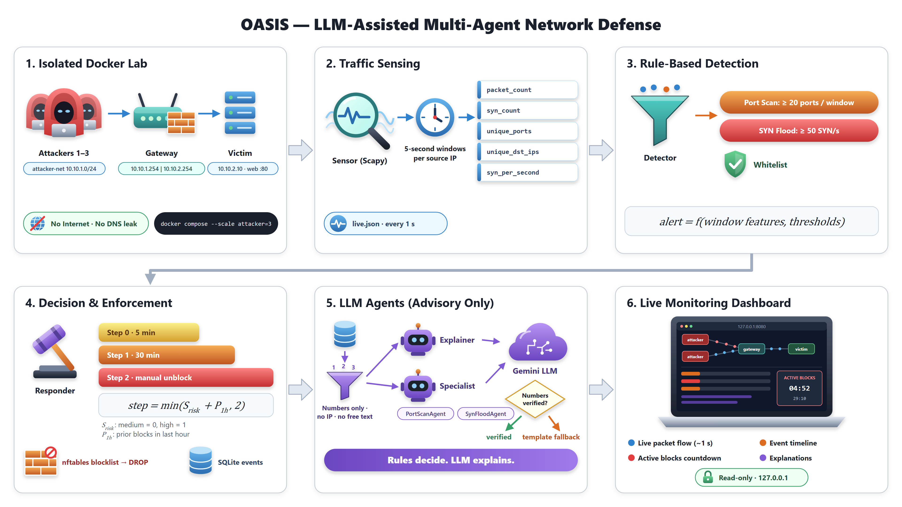

# OASIS — LLM and Multi-Agent Network Defense

> **Warning: for isolated lab use only.** OASIS generates attack traffic (port scans,
> SYN floods) and changes firewall rules. Run it only in the Docker lab described here
> or in a lab VM you control. Never point the attacker tools at networks or hosts you
> do not own or have explicit permission to test.

OASIS is a graduation project: a small network defense system that watches traffic,
detects attacks with rules, blocks the attacker with nftables, and then asks LLM agents
to explain the decision and give a second opinion.

This branch (`docker`) moves the project from a set of VMs into Docker containers.
The working VM version stays on `main` and is tagged **`demo-v2`**.



## Core principle

- **Blocking decisions are made by rules, not by the LLM.** The detector and the
  responder are plain code with fixed thresholds and a fixed action ladder. The LLM
  agents are advisory only: they never touch the firewall and never change the risk level.
- **Only numeric fields are sent to the LLM.** Agents get packet counts, rates,
  thresholds and a few fixed enum values (`port_scan`, `medium`, `block`, ...).
  No IP addresses and no free text from traffic or alerts are sent.
- **LLM output is checked.** Every number in an LLM answer must appear in the evidence;
  otherwise the answer is rejected and a rule-based template is stored instead.

## Architecture

### Pipeline

```
 sensor ──windows.jsonl──> detector ──alerts.jsonl──> responder ──oasis.db──> explainer
 (scapy, 5 s windows)      (rules)                    (nftables)        └───> specialist
```

| Component | Role | Talks to the LLM? | Touches the firewall? |
|---|---|---|---|
| `sensor.py` | Sniffs the gateway's attacker-side interface, writes per-source 5-second summaries (and, in Docker, per-target summaries for the distributed rule, forged-ARP findings for the MITM rule and a per-second live summary for the dashboard, including packets one host relays for another) | No | No |
| `detector.py` | Per-source rules, first match wins: ≥ 20 distinct SYN ports in a window → `port_scan`; ≥ 50 SYN/s → `syn_flood`; ≥ 1 SYN to a tripwire port (Docker lab: 21, 23, 445, 3389) → `tripwire`. Per-target rule: ≥ 20 ports of one target from ≥ 2 sources with ≥ 3 ports each, none of them ≥ 20 alone → `distributed_scan` for each of those sources. ARP rule: ≥ 1 forged ARP claim (the gateway's IP, or an IP another host used in the last 30 s) → `arp_spoof` for the IP behind that MAC | No | No |
| `responder.py` | Whitelist → risk level → action ladder → nftables blocklist → SQLite event log; for `arp_spoof` also an ARP blocklist for the MAC, a drop of every frame from that MAC, a flush of the poisoned gateway ARP entries and, while the MAC stays blocked, gratuitous ARP for the gateway's real MAC. In the Docker lab it also carries out unblock requests from the dashboard (checked again: valid IP, really in the blocklist) | No | **Yes** |
| `explainer.py` | Explains each block in Turkish (3–4 sentences), number-verified | Yes (numbers only) | No |
| `specialist.py` | Router picks `PortScanAgent` or `SynFloodAgent` for a second opinion (JSON) | Yes (numbers only) | No |
| `unblock.py` | Manual unblock (IP, and the MAC of an ARP spoofing block from both MAC sets), logged to the event table | No | **Yes** |
| `policy.py` | Action ladder constants and the repeat count, shared by the responder and the agents (no firewall code) | No | No |
| `dashboard.py` | Web view of `oasis.db` for the analyst: lab diagram, events, explanations, opinions, active blocks. Its only write is an unblock request appended to a queue file; the responder carries it out | No | No |

**Block duration ladder** (`responder.py`): `LADDER = [5 min, 30 min, until manual unblock]`.
The start step comes from the risk level (`port_scan` = medium → step 0,
`syn_flood` = high → step 1). Each earlier block of the same IP in the last hour moves it
one step up. Unblocking does not reset that count.

### Docker network layout

```
                 attacker-net 10.10.1.0/24             victim-net 10.10.2.0/24
 ┌───────────┐   (no NAT, auto IPs .64-.127)   ┌─────────┐   (no NAT)   ┌──────────┐
 │ attacker  │──────────────────────────────── │ gateway │──────────────│  victim  │
 │ (scalable)│   default route → .1.254        │ .1.254  │  .2.254      │ .2.10    │
 └───────────┘                                 │ .2.254  │              │ web :80  │
                                               └────┬────┘              └──────────┘
                              shares the gateway's  │ network namespace
                                      ┌─────────────┴────────────┐
                                      │  sensor (NET_RAW)        │
                                      │  responder (NET_ADMIN)   │
                                      └──────────────────────────┘
   detector: network_mode none         oasis-data volume: windows.jsonl, alerts.jsonl, oasis.db, live.json
                                       (shared by sensor, detector, responder, explainer, specialist)
                 mgmt 10.10.9.0/24 (NAT on — the only network with internet access)
              ┌────────────┐ ┌────────────┐
              │ explainer  │ │ specialist │ ──> LLM API (Gemini or Anthropic)
              └────────────┘ └────────────┘
                 dash 10.10.8.0/24 (only network of the dashboard)
              ┌────────────┐
              │ dashboard  │ ──> 127.0.0.1:8080 on the host; oasis-data mounted read-only
              └────────────┘     unblock requests: oasis-requests volume → responder
```

How the lab is kept offline and isolated:

- Lab networks have **no NAT** (`enable_ip_masquerade: false`).
- The gateway **removes its default route** and loads a separate nftables table,
  `inet lab_isolation`, that only forwards traffic between the two lab subnets.
  The OASIS blocklist lives in its own table, `inet oasis`, so the responder never touches
  the isolation rule.
- Lab containers use the gateway as their **DNS upstream**, and no DNS server runs there.
  External names do not resolve, which closes a DNS tunnel path through Docker's
  embedded DNS. Names on shared networks (for example `gateway`) still resolve.
- The lab networks are **not** `internal: true`, on purpose: Docker then drops routed
  traffic between the two subnets, so the gateway could not route at all.

Least privilege: every OASIS service starts with `cap_drop: [ALL]`. The sensor gets
`NET_RAW` (sniffing) and the responder `NET_ADMIN` (nftables) plus `NET_RAW`, used only to
send the gateway's corrective ARP announcements after ARP spoofing (unset
`OASIS_ARP_DEFEND_IP`, as on the VM, sends none). The detector has no network at all.
The dashboard gets no capabilities, runs as `nobody` with a read-only root file system and
`no-new-privileges`, mounts `oasis-data` read-only and is not on the lab or mgmt networks.
Its only writable mount is the small `oasis-requests` volume for unblock requests; it never
runs `nft` and never writes to the database.
`.env`, `data/` and `.git` are excluded from images by `.dockerignore`.

## Setup and usage

Requirements: Docker with Compose v2.24 or newer (tested on Docker Desktop 29.7 for Windows).

```bash
git clone https://github.com/mustafaonler/oasis-network-defense.git
cd oasis-network-defense
git switch docker
```

### API key (optional)

Without a key, the explainer and specialist fall back to rule-based templates, and
everything else works the same.

```bash
cp .env.example .env
```

Open `.env` in an editor and fill in **one** provider key (`GEMINI_API_KEY` or
`ANTHROPIC_API_KEY`). `.env` is ignored by git and never copied into an image.
`OASIS_MODEL` can override the model. With Gemini, `OASIS_MODEL=gemini-3.5-flash-lite`
was tested and is recommended, because the code default `gemini-2.5-flash` is deprecated.
Leave that line commented out unless you set a value, because an empty `OASIS_MODEL=`
makes every LLM call fail.

### Start

```bash
docker compose up -d --build
docker compose ps
docker compose logs -f sensor detector responder explainer specialist
```

After you create or change `.env`, recreate the agents so they pick it up:

```bash
docker compose up -d --force-recreate explainer specialist
```

### Example tests

```bash
# attacker's current IP (no fixed IP, it comes from 10.10.1.64/26)
docker compose exec attacker ip -4 -br addr show eth0

# normal traffic: no alert
docker compose exec attacker curl -s http://10.10.2.10/

# small scan below the threshold: no alert
docker compose exec attacker nmap -Pn -sS -p 1-15 10.10.2.10

# port scan: port_scan alert -> block
docker compose exec attacker nmap -Pn -sS -p 1-30 10.10.2.10

# limited SYN flood (5000 packets, not --flood): syn_flood alert -> block
docker compose exec attacker hping3 -S -p 80 -c 5000 -i u1000 -q 10.10.2.10

# see the blocklist and remove a block
docker compose exec gateway nft list set inet oasis blocklist
docker compose exec responder python3 src/unblock.py <attacker-ip>

# watch traffic pass through the gateway
docker compose exec gateway tcpdump -ni any icmp

# several attackers: start three, run a command in the second one, go back to one
docker compose up -d --scale attacker=3
docker compose exec --index 2 attacker nmap -Pn -sS -p 1-30 10.10.2.10
docker compose up -d --scale attacker=1
```

Stop the lab with `docker compose down`. To also delete the event database, add `-v`.

### Scenario

One command runs a staged attack chain while a normal user browses, checks every phase
against the event log and prints a PASS/FAIL report (about 2.7 minutes, five attacker
containers):

```bash
bash scripts/scenario.sh
```

| Phase | What happens | Expected |
|---|---|---|
| 0 | A normal user (`user` service) curls the victim every 1–3 s for 30 s | no alert |
| 1 | Attacker a1: quick recon, 15 ports | no alert |
| 2 | a1: full scan, 100 ports | `port_scan`, a1 blocked |
| 3 | The attacker hops to a new IP (a2) and sends one quiet SYN to 3389 | `tripwire`, a2 blocked |
| 4 | Two more IPs (a3, a4) split a scan, 10 ports each, no tripwire port | `distributed_scan`, a3 and a4 blocked |
| 5 | The admin unblocks a1, which starts a SYN flood (3000 SYN) | `syn_flood`, a1 blocked again |
| 6 | MITM attempt: a5 tells the gateway that the user's IP is at a5's MAC (3 forged ARP replies) | `arp_spoof`, a5 blocked, the gateway's entry for the user back at the user's real MAC |
| all | The normal user | never blamed, still gets HTTP 200 |

The `user` service only exists in the `scenario` compose profile, so a normal
`docker compose up` never starts it. It uses the attacker image (local only,
`pull_policy: never`) with `NET_ADMIN` for its route and no raw sockets, and it is not
whitelisted. The script checks block types, not durations: those depend on each IP's
blocks in the last hour. LLM results are reported for information only. The script never
starts Docker; if the daemon is down it says so and exits with code 2. At the end it
removes every block, stops the user and goes back to one attacker.

### Dashboard

Open <http://127.0.0.1:8080> on the Docker host. The page refreshes every 5 seconds and shows:

- **Lab diagram** with a status per host: *engelli* (blocked), *alarm* (an attack event in
  the last 5 minutes) or *normal*. Attackers shown are the IPs with an event in the last
  hour or a block still in force.
- **Active blocks** with a live countdown, computed from the event log only (newest
  enforce-mode `block` per IP, minus later `unblock` events and expired durations).
  The dashboard never asks the gateway.
- **Events** (newest 200). Click a row for the rule reason, the explainer text, the
  specialist opinion and the sensor evidence.

**Unblock button.** In the Docker lab every active block, and the event row that started
it, has an *Engeli kaldır* button. The first click arms it for 5 seconds (*Onayla: kaldır*),
the second click sends the request. The dashboard itself cannot unblock anything: it only
appends `{"ip": …}` to `requests/unblock.jsonl` on the `oasis-requests` volume. The
responder reads new lines every idle second, checks again that the IP is valid and really
in the gateway's blocklist, then runs the same code as `unblock.py` (IP, the MAC of an ARP
spoofing block, and an `unblock` event with the reason `unblock from dashboard`). Requests
already waiting when the responder starts are not replayed. `OASIS_REQUEST_DIR` unset
(the VM) hides the button and refuses every `POST`.

**Live traffic.** In the Docker lab the sensor also writes `data/live.json`: per-source
packet, SYN and distinct-port counts for each of the last 10 seconds, rewritten atomically
every second (under 1 KB in tests, at most about 64 sources × 10 seconds). It also counts,
per source, the packets that really leave the gateway on the victim side (a raw socket
with a kernel BPF filter, in a child process so it never slows the scapy sniffer). The
dashboard pushes this file to the browser as Server-Sent Events (`/api/live`, at most 4
streams). The diagram then shows:

- a live `pkt/s` value on every attacker box, and `incoming · forwarded pkt/s` on the gateway;
- dots on the attacker → gateway → victim path. For every measured second a source gets
  one dot per packet up to 10 pkt/s, above that a log scale (at most 30 dots per source per
  second, 120 on screen). The share of dots that cross to the victim is the measured
  forwarded share; the rest stop at the gateway in red. A blocked attacker's dots all stop
  at the gateway, because nothing of it leaves on the victim side.

No traffic means no dots. With the sensor stopped, the page says so and draws nothing.
`OASIS_LIVE_FILE` unset (the VM) turns all of this off and the sensor behaves as before.

Security: `GET` plus one `POST` (`/api/unblock`, only with the request queue on); the `Host`
header must be `127.0.0.1:8080` or `localhost:8080` (against DNS rebinding), a strict
Content-Security-Policy allows only the page's own files, and every database string is
written with `textContent`, so it is shown as plain text and never parsed as HTML. The page
loads nothing from a CDN. The `POST` also needs `Origin` equal to the page's own address,
the header `X-OASIS-Action: unblock` and `Content-Type: application/json` (a foreign web
page cannot send these without a CORS preflight, which the dashboard never answers), a
body of at most 256 bytes with a valid IP that is currently blocked, and at most 10
requests per minute. The queue file is opened with `O_NOFOLLOW` and capped at 1 MB.
If you publish the dashboard on another host port, change `OASIS_DASH_HOSTS` to match.

Unit tests (run inside the images, no Python needed on the host):

```bash
docker compose build dashboard sensor explainer
docker run --rm --network none -v "$PWD/tests:/app/tests:ro" oasis/dashboard:dev python3 -m unittest discover -s tests -p test_dashboard.py -v
docker run --rm --network none -v "$PWD/tests:/app/tests:ro" oasis/core:dev python3 -m unittest discover -s tests -p test_sensor.py -v
docker run --rm --network none -v "$PWD/tests:/app/tests:ro" oasis/core:dev python3 -m unittest discover -s tests -p test_detector.py -v
docker run --rm --network none -v "$PWD/tests:/app/tests:ro" oasis/agents:dev python3 -m unittest discover -s tests -p test_retry.py -v
docker run --rm --network none -v "$PWD/tests:/app/tests:ro" oasis/core:dev python3 -m unittest discover -s tests -p test_arp.py -v
docker run --rm --network none -v "$PWD/tests:/app/tests:ro" oasis/core:dev python3 -m unittest discover -s tests -p test_unblock_requests.py -v
```

## Test results

All tests were run manually on Docker Desktop (Windows). Each test was compared with an
expected result written down before it ran.

### Stage A — gateway, attacker, victim

| # | Test | Result |
|---|---|---|
| 1 | `compose up`: 2 networks, 3 containers | Pass |
| 2 | Gateway finds its interfaces by IP; nft tables loaded | Pass |
| 3 | Fixed IPs (.1.254, .2.254, .2.10); attacker IP from `ip_range`; gateway has no default route | Pass |
| 4 | Ping attacker → victim; tcpdump shows every packet crossing `eth0 ↔ eth1` on the gateway | Pass |
| 5 | No internet from attacker, victim or gateway (ICMP and TCP) | Pass |
| 6 | Bypass attempt (attacker route via the Docker host bridge) fails | Pass |
| 7 | Adding the attacker to the blocklist drops its traffic | Pass |
| 8 | Removing it restores traffic | Pass |
| 9 | External DNS names do not resolve; `gateway` still resolves | Pass |

### Stage B — sensor, detector, responder

| # | Test | Result |
|---|---|---|
| B1 | All services up; sensor finds its interface itself; gateway DNS closed | Pass |
| B2 | Without `OASIS_*` variables the code keeps the exact VM values (no regression on `main`) | Pass |
| B3 | Normal traffic and a 15-port scan: no alert; 30-port scan: `port_scan`, block 5 min | Pass |
| B4 | 100-port scan by the same IP: block **30 min** (repeat escalation) | Pass |
| B5 | `unblock.py` restores traffic and logs an `unblock` event | Pass |
| B6 | 5000 SYN (~890 SYN/s): `syn_flood`, block **until manual unblock** (high risk + two earlier blocks) | Pass |

### Stage C — explainer, specialist

| # | Test | Result |
|---|---|---|
| C1 | Both agents up on the mgmt network, no restarts | Pass |
| C2 | No key variables inside the containers when `.env` is absent | Pass |
| C3 | Without a key: `[mock]` explanations and `[rules]` opinions for all block events | Pass |
| C4 | From the explainer: ping and TCP to victim and attacker fail; mgmt and internet pings work | Pass |
| C5 | LLM payloads for real events contain no IP address and no free text | Pass |
| C6 | Real LLM call with a Gemini key: both agents labelled `gemini:gemini-2.5-flash (verified)` | Pass |
| C6b | Same test with `OASIS_MODEL=gemini-3.5-flash-lite`: both agents labelled `gemini:gemini-3.5-flash-lite (verified)` | Pass |

C6 first failed: google-genai 3.x uses the `v1` API by default, and there
`gemini-2.5-flash` rejects `system_instruction` (HTTP 400). Both agents fell back to
templates as designed. The fix sets `api_version="v1beta"` on the Gemini client.

### Fix: repeat count in the LLM payload

| # | Test | Result |
|---|---|---|
| F1-R | Responder dry-run scenario (repeats, expiry, whitelist, unknown type, bad IP): same DB rows and output as `main` (VM env) and as the previous commit (VM and Docker env) | Pass |
| F1-A | Agents do not load `responder.py`; `policy.py` imports nothing | Pass |
| P1 | For every stored block, the computed ladder step matches the duration the responder applied | Pass |
| P2 | Template explanations give the repeat count as the reason | Pass |
| P3 | Same new IP blocked twice: 5 min (start step), then 30 min with "1 prior block" as the reason; both agents `(verified)` | Pass |
| P4 | New payloads contain no IP address and no free text | Pass |

### Fix: DNS lookups not counted as scan targets

| # | Test | Result |
|---|---|---|
| R1 | VM settings (no `OASIS_*`): BPF, interface and statistics for the same in-memory packets are identical to `main` | Pass |
| R2 | Docker settings, in-memory packets: a DNS lookup to the gateway is no longer a target; a SYN to the gateway's port 22 still is; DNS to another server still is; packet counts unchanged | Pass |
| R3 | Live 30-port scan: `unique_dst_ips` is 1 (was 2), `port_scan` alert as before | Pass |

### Stage D — several attackers (`--scale attacker=3`)

| # | Test | Result |
|---|---|---|
| D1 | Three attackers get distinct IPs from `10.10.1.64/26`; route and DNS point at the gateway | Pass |
| D2 | A ping from each attacker crosses the gateway (three source IPs in tcpdump) | Pass |
| D3 | Simultaneous 30-port scans: three windows, three `port_scan` alerts, three blocks; durations follow each IP's own history | Pass |
| D4 | Unblocking one attacker restores only that attacker; the other two stay blocked | Pass |
| D5 | Distributed scan (10 ports per attacker, 30 in total): no alert, as expected for per-source rules (see limitations) | Pass |
| D6 | The agents handled all three events: six verified LLM results, no rate-limit errors | Pass |
| D7 | Blocklist empty, back to one attacker | Pass |

### Dashboard

| # | Test | Result |
|---|---|---|
| U1 | 17 unit tests: blocklist from the log (active, expired, unblocked, re-blocked, manual, `block_failed`, dry-run, `unblock_failed`), host status, read-only connection, missing DB not created, CSP, no HTML sinks in the JS, raw text in the API, wrong `Host` → 403, non-GET → 405, no file access from the URL | Pass |
| K1 | `docker inspect`: no added capabilities, all dropped (CapEff 0), `oasis-data` mounted `RW=false`, user `nobody`, read-only root, port bound to `127.0.0.1:8080`, only on the `dash` network | Pass |
| K2 | From inside the container: writing to the volume and the root file system fails; a normal SQLite `INSERT` fails (read-only database); TCP to victim and gateway times out | Pass |
| K3 | Live 30-port scan: event, `blocked` status, 5-minute countdown, explainer text and specialist opinion appear in the browser | Pass |
| K4 | `unblock.py`: the IP leaves the block list, status turns to `alarm`, the `unblock` event is listed | Pass |
| K5 | Browser loads resources only from `http://127.0.0.1:8080`; no horizontal page scroll at 375 px and 1024 px | Pass |
| K6 | Separate test DB with HTML and script payloads in every text field: shown as plain text, no ``/`<b>`/extra `<script>` elements, no injected attributes or classes, page title unchanged | Pass |

### Dashboard: live traffic

The browser checks used a small test driver that called the page's own `frame()` about
60 times a second (the browser pane was in the background, where animation frames do not
run) and measured the time of every frame. The dots came from the real SSE stream.

| # | Test | Result |
|---|---|---|
| U2 | Unit tests: sensor windows identical with the live summary on and off for the same in-memory packets; VM defaults (BPF, interface, live off); per-second counts; 64-source cap; live file keeps 10 seconds, no temp file, stops growing. Dashboard: bad IPs and non-integer counters dropped, stale / missing / oversized / malformed file, 10-second and 64-source limits, SSE headers and CSP, update after the file changes, wrong `Host` → 403, fifth stream → 503 (24 + 5 tests) | Pass |
| L1 | One attacker: ping shows 1 pkt/s and one dot per second reaching the victim; curl ×3 shows 6 and 12 pkt/s; nmap (15 ports) shows 18 in / 15 forwarded, the 3 not forwarded are packets to the gateway itself and stop there in red. Values appear about 1 s after the traffic | Pass |
| L2 | Traffic stops: `pkt/s` back to 0 within about 1 s, dots in flight finish within 3 s, no new dots afterwards. No traffic, no dots | Pass |
| L3 | Three attackers ping at 1, 2 and 5 pkt/s at once: three boxes, three paths, values 1/2/5; a traffic-only attacker leaves the diagram 10 s after its last packet | Pass |
| L4 | Continuous ping (5 pkt/s) plus a 30-port scan from the same attacker: forwarded 5/5 before the block, 5/0 after it; every dot stops at the gateway; box turns `blocked`. An ACK flood from the blocked attacker: 4171 in, 0 forwarded, no dot past the gateway | Pass |
| L5 | ACK flood, 20000 packets at about 6500 pkt/s, sensor with the live summary on (5 runs) and off (4 runs): captured 19862–20000 on, 19947–20000 off; forwarded counter 20000 in every run; CPU about the same. Browser during the flood and the README SYN flood: 53–63 frames/s, average frame 0.06 ms, worst 2.6 ms, at most 64 dots, constant SVG node count, no heap growth | Pass |
| L6 | `live.json` stayed between 600 and 900 bytes during the floods; no temp file left in `data/` | Pass |

L5 failed in the first version: the forwarded counter ran as a thread in the sensor
process and competed with the scapy sniffer for the GIL. Under the flood it missed 19–25 %
of forwarded packets and the 5-second windows lost up to 5.5 %. It now runs as a child
process that sends its counts ten times a second.

### Measurement: time to stop a SYN flood

Method: a limited SYN flood (`hping3 -S -p 80 -c 5000 -i u1000`, about 1000 SYN/s) from an
attacker with no block in the last hour, three runs with three different attackers. All
containers share the host kernel clock, so the timestamps are comparable.

- **T0**: first SYN from the attacker seen on the gateway's victim-side interface
  (`tcpdump -tt` on `eth1`), i.e. the first packet that reached the victim.
- **T1**: last SYN from the attacker seen there. After the block nothing more is forwarded.
- **Tresp**: the responder's event time for the block (`events.epoch`, taken just before
  the `nft` command), as a cross-check.
- A run counts only if fewer than 5000 SYN reached the victim, i.e. the block came while
  the flood was still running.

| Run | SYN that reached the victim | T1 − T0 (first SYN → stopped) | T1 − Tresp |
|---|---|---|---|
| 1 | 4318 / 5000 | 5.305 s | 0.006 s |
| 2 | 1929 / 5000 | 2.373 s | 0.006 s |
| 3 | 3127 / 5000 | 4.086 s | 0.006 s |

**Min 2.37 s, max 5.31 s, mean 3.92 s.** The spread comes from where the flood starts inside
the sensor's 5-second window: the alert is raised only when that window closes, plus the
detector and responder poll their input files every 0.5 s. Once the responder decides,
the gateway stops forwarding within about 6 ms.

### Tripwire ports

No lab service runs on 21, 23, 445 or 3389 (`OASIS_TRIPWIRE_PORTS`), so a single connection
attempt there is treated as a probe: risk medium, 5-minute block, escalating on repeats.
Rule order: `port_scan` and `syn_flood` are checked first, so a big scan that also touches
a tripwire port keeps the more telling name. Without the variable (VM) nothing changes.

| # | Test | Result |
|---|---|---|
| U3 | Unit tests: sensor counts only SYNs to tripwire ports, other window fields unchanged, no field in the VM, bad port lists rejected (4); detector rule order, whitelist, VM windows without the field (8) | Pass |
| R1 | VM settings: sensor statistics and BPF, detector decisions for 6 windows, and the responder dry-run scenario (VM and Docker whitelist) identical to the previous commit | Pass |
| T1 | Normal use: 30 `curl` requests in 60 s, 15 windows with at most 1 port and 0.4 SYN/s, `tripwire_hits` 0 | Pass, no alert |
| T2 | One SYN to port 23 | `tripwire`, block 5 min, ping lost |
| T3 | IP hopping: three attackers each send one SYN to 3389 | every new IP blocked on its first packet (the already blocked one: `skip_already_blocked`) |
| T4 | 15-port scan without tripwire ports | no alert (unchanged) |
| T5 | 30-port scan that includes 21 and 23 (`tripwire_hits` 2) | reported as `port_scan`, not `tripwire` |
| R2 | LLM payloads of tripwire events: only counts (`tripwire_hits` added), no IP, no free text | Pass |
| R3 | Agents on tripwire events: 4 of 6 results `(verified)` live, 2 fell back to templates on Gemini HTTP 5xx; both retried and came back `(verified)` | Pass |
| R4 | Dashboard lists the tripwire events | Pass |

### Distributed scans

With `OASIS_TARGET_FILE` set, the sensor also writes, for every target that at least two
sources sent SYNs to in a window, how many distinct ports each source probed. The detector
raises `distributed_scan` (risk medium) for every source with ≥ 3 ports when together they
probed ≥ 20 ports of that target and none of them reached 20 alone (that one is already a
`port_scan`). The 3-port floor keeps a normal user who only touched port 80 out of it.
Only counts reach the LLM; the target IP stays in the database.

| # | Test | Result |
|---|---|---|
| U4 | Unit tests: per-target counts (only SYNs, per source), source windows unchanged, no collection in the VM (3); rule cases DS1–DS4, single contributor, whitelist (7) | Pass |
| R1 | VM settings: sensor, detector and responder identical to the previous commit; payloads and template texts of all 27 stored block events unchanged | Pass |
| DS1 | Three attackers probe 30–39, 40–49 and 50–59 at once (10 ports each) | target record: 4 sources, 31 ports; `distributed_scan` and a block for each of the three |
| DS2 | A fourth container browses (`curl` every second) during DS1 | not blamed (1 port), 15/15 requests answered, never blocked |
| DS3 | Two attackers, 5 ports each (10 in total) | no alert |
| DS4 | One attacker probes 30 ports while another probes 5 | only `port_scan` for the first; no `distributed_scan`, the second is not blamed |
| R2 | LLM payloads: only counts (`target_unique_ports`, `distributed_sources`, this source's ports); no source or target IP, no free text | Pass |
| R3 | Agents: all six live calls fell back on Gemini HTTP 5xx; retried, the specialist and (on the second try) the explainer returned `(verified)` with the right reason for the duration | Pass |
| R4 | Dashboard lists the three `distributed_scan` events | Pass |

### Scenario runs

Two runs back to back with `bash scripts/scenario.sh`, both exit code 0:

| Run | Checks | Time | Block durations seen | LLM (explainer / specialist verified of 5) |
|---|---|---|---|---|
| 1 | 9 / 9 PASS | 2 min 26 s | 5 min to manual (IPs already had blocks that day) | 5 / 2 |
| 2 | 9 / 9 PASS | 2 min 21 s | mostly manual (more prior blocks) | 2 / 2 |

The LLM fallbacks were Gemini HTTP 5xx errors on that day; the blocks did not depend on them.

### LLM retry on transient errors

`src/retry.py`, used by both agents: after an HTTP 5xx, a timeout or a dropped connection
the call is tried once more after 2 s. Client errors (400, 401, 404, 429), bad JSON and
numbers missing from the evidence are not retried. A result that needed the retry is
labelled `(verified) [retry]`; a failed retry is marked in the fallback (`tekrar denendi`,
`retried`).

| # | Test | Result |
|---|---|---|
| U5 | 12 unit tests with fake LLM calls: first try, 5xx then success, 5xx twice, 400/401/404/429 not retried, Anthropic 529 and timeouts retried, bad JSON not retried; labels and fallback texts of both agents | Pass |
| R1 | Payloads and template texts of all 41 stored block events identical to the previous commit | Pass |
| L1 | Live: a model name that does not exist (HTTP 404) falls back at once, no retry, 0.4–0.5 s per call | Pass |
| L2 | Live: third scenario run, 9 / 9 PASS. LLM: 8 of 10 calls verified (one of them after the retry), 2 fallbacks after a failed retry. The two runs before the retry: 7 / 10 and 4 / 10 | Pass |

The retry helps but is not a cure: when Gemini is overloaded, a second try 2 s later can
fail too. A longer delay or a second retry would trade more of these for slower fallbacks.

### MITM / ARP spoofing

With `OASIS_ARP_FILE` set, the sensor also reads every ARP message on the gateway's
attacker-side interface (each one claims "this IP is at this MAC") and flags two kinds of
forged claims, per window and per sending MAC:

- **gateway impersonation**: the gateway's own IP from a MAC that is not the gateway's;
- **address conflict**: an IP that another MAC used within the last 30 s.

The offender is found by its MAC: the sensor remembers the first IP each MAC used, and never
overwrites it, so a MITM that relays someone else's packets is not given their IP. The
detector raises `arp_spoof` (risk high, 30-minute start). The responder then also adds the
MAC to an nftables `arp` blocklist (the gateway ignores its ARP for the block's duration)
and flushes the gateway's ARP entries for the claimed IPs, so they are learned again from
their real owners. Only counts go to the LLM; MACs and IPs stay in the database.

What a forged claim did to the gateway in test M3, and how the response undid it:

| Moment | Gateway's ARP entry for the user | |
|---|---|---|
| before | the user's real MAC | normal |
| 1 s after 3 forged replies | **the attacker's MAC** | poisoned: replies to the user would go to the attacker |
| after the responder (about 5 s) | the user's real MAC again | entry flushed and learned again |

| # | Test | Result |
|---|---|---|
| U6 | 14 unit tests: VM learns nothing; impersonation; own ARP and probes ignored; normal replies learned; conflict only within 30 s; relayed packets do not change who the attacker is; detector cases; responder: bad MACs never reach a command, MAC block with the same timeout, only valid IPs flushed | Pass |
| R1 | VM settings: sensor, detector and responder identical to the previous commit; explainer payloads and all template texts of 46 stored events unchanged; specialist payloads differ only by one new lab-baseline number (`normal_traffic_forged_arp_claims: 0`) | Pass |
| M1 | 30 s of normal traffic (user browsing, attacker pinging), with real ARP between the hosts | no finding, no alert |
| M2 | 3 forged broadcasts "10.10.1.254 is at my MAC" | `gw_impersonation` 3, `arp_spoof`, IP and MAC blocked for 30 min, ping lost |
| M3 | 3 forged replies to the gateway claiming the user's IP | `binding_conflicts` 3, `arp_spoof` for the attacker (not the user), poisoned entry repaired, user gets HTTP 200 |
| M4 | The blocked MAC sends the same forged replies again | the gateway's entry stays correct (ARP dropped by nftables); `skip_already_blocked` |
| R2 | LLM payloads: three counts only; no IP, no MAC, no free text | Pass |
| R3 | Agents on the two events: 4 / 4 `(verified)`, one after a retry | Pass |
| R4 | Dashboard lists the `arp_spoof` events | Pass |
| S | Scenario with the new phase 6, run twice: 11 / 11 PASS each (2 min 38 s), LLM 12 / 12 verified both times | Pass |

### MITM: a real attack, visible in the dashboard

Three forged ARP packets are enough for the rule, but they show nothing: no traffic is
redirected. The attacker image now has `mitm.py`, a lab-only man in the middle (it refuses
addresses outside its own subnet). Every second it tells the target "the gateway is at my
MAC" and the gateway "the target is at my MAC". Docker containers forward packets
(`ip_forward=1`), so the target keeps working while its traffic passes through the
attacker, and `mitm.py` prints the requests and replies it sees.

```bash
# a host that browses (here attacker 3 plays the normal user)
docker compose exec --index 3 attacker sh -c 'while true; do curl -s -o /dev/null -w "%{http_code}\n" http://10.10.2.10/; sleep 1; done'
# the man in the middle (attacker 1), Ctrl+C stops it and repairs the target's entry
docker compose exec --index 1 attacker mitm.py <ip of attacker 3>
```

What makes it visible, and what the defense now adds:

- **Sensor (live view only):** a packet whose source IP belongs to one host but arrives from
  the MAC of another host was relayed. The live summary counts these per second
  (`relayed`, `via`) and the forged ARP claims per sender (`arp`). A relaying MAC never
  becomes the owner of the IP it relays, also after 30 s.
- **Dashboard:** forged claims are purple dots from the sender to the gateway; relayed
  packets loop from the victim's box through the attacker's box (purple dashed path), with
  the tags *MITM kurbanı* and *sahte ARP n/s*.
- **Responder:** besides the IP and the ARP blocklist, every frame from the blocked MAC is
  dropped in `inet oasis` (relayed packets carry the victim's IP, so the IP blocklist alone
  would let them through). The gateway cannot stop frames between two other hosts, so
  while a MAC is blocked it announces its real MAC every 0.3 s (gratuitous ARP). Linux
  always accepts a gratuitous ARP and then ignores ordinary forged replies for about a
  second, so the victim's entry is corrected and stays correct. The announcements stop by
  themselves when no MAC is blocked any more (checked every 5 s).

| # | Test | Result |
|---|---|---|
| U9 | 9 new unit tests (23 ARP tests in total): relay never becomes owner; relayed packets and forged claims per second, own traffic and normal ARP not counted, VM counts nothing; frame drop rule and element; gratuitous ARP bytes; blocked-MAC check; `unblock.py` clears both MAC sets. Dashboard: `relayed` / `via` / `arp` validated (31 tests) | Pass |
| M5 | User (attacker 3) browses every second, `mitm.py` on attacker 1 for 25 s | see below |

M5 timeline (sampled once a second):

| Time | Victim's ARP entry for the gateway | Relayed packets per s | `mitm.py` |
|---|---|---|---|
| t+1 s | gateway's real MAC | 0 | starts poisoning |
| t+2…5 s | **attacker's MAC** | 7 of 7 | prints `GET / HTTP/1.1`, `HTTP/1.0 200 OK`, page text |
| ≈ t+6 s | responder: `arp_spoof` → IP and MAC blocked, frames dropped, gateway entry flushed, announcements start | | |
| t+7…41 s | real MAC again (one sample at t+14 s showed the attacker's MAC, the next one was correct) | 0 | `last 5 s: 0 packets passed through me` |

The user got 45 / 45 HTTP 200: the attack and the defense never broke its traffic.
`unblock.py` then removed the MAC from both sets and the announcements stopped (170 sent).
In the browser, the purple path and both tags appeared during the attack and the looping
dots stopped with the block.

### Dashboard: unblock button

| # | Test | Result |
|---|---|---|
| U7 | Dashboard (29 unit tests in total): request queue off → `POST` 405 and no button; correct request queued (202); wrong `Origin`, missing action header, wrong content type, bad IP, IP not blocked and oversized body refused (403 / 415 / 400 / 409 / 413) and nothing written; 11th request in a minute → 429 | Pass |
| U8 | Responder (5 unit tests): VM reads no requests; request directory `1733`, file left to the dashboard; requests waiting before the start are not replayed; only valid and really blocked IPs are unblocked; nothing lost above 20 requests per round | Pass |
| K7 | `docker inspect`: dashboard still user `nobody`, read-only root, no capabilities, `oasis-data` `RW=false`; only `oasis-requests` is writable | Pass |
| L1 | Live: wrong `Origin` → 403, IP not blocked → 409 | Pass |
| L2 | Live: two clicks on *Engeli kaldır* for a blocked attacker: IP leaves the nftables set within 2 s, its ARP-block MAC too, `unblock` event with reason `unblock from dashboard` | Pass |
| L3 | From an attacker container: `host.docker.internal` does not resolve, dashboard port `10.10.8.2:8080` filtered (the attacker was not blocked at the time) | Pass |

## Known limitations

- **Simple detection.** There are two rules with fixed thresholds over 5-second windows.
  A slow scan (fewer than 20 new ports per window) is not detected. A scan that straddles
  two windows can stay under the threshold in both.
- **A fast attack can finish before the block.** Alerts come only when a 5-second window
  closes, and the responder acts after that. A fast scan can be over before its window ends
  (in testing, nmap probed 30 ports in 0.1 s and the block came about 4 s later). The block
  then stops the attacker's next step, not the scan that triggered it. A SYN flood was
  stopped 2.4–5.3 s after its first packet (see "Measurement: time to stop a SYN flood").
- **Distributed scans: covered within one window only.** The per-source rules alone missed
  three attackers that each probed 10 ports (Stage D, test D5). The distributed rule now
  catches that case (test DS1), and tripwire ports catch any source that touches them
  (test T3). Still missed: a scan spread over several windows (for example 5 ports every
  10 s from changing IPs), a scan split into pieces of fewer than 3 ports per source, and
  scans spread over many targets. A longer sliding window per target would narrow this.
- **Tripwire limits.** It only covers the four listed ports, so an attacker who skips them
  is not caught by this rule. Detection still waits for the 5-second window (0–5 s). A
  misconfigured client that tries one of these ports gets a 5-minute block; the specialist
  tends to suggest `lower` for a single probe, which is advisory only.
- **Recycled lab IPs keep their history.** Docker hands a freed address to the next
  attacker container, so a new container can inherit an old IP's recent blocks and get a
  longer block on its first scan.
- **ARP spoofing: what the gateway cannot see or fix.** It only sees ARP that reaches its
  own interface: a forged reply sent straight to another host (for example telling the user
  "I am the gateway" by unicast) is invisible to it, and it cannot repair other hosts' ARP
  caches; that needs switch-level protection such as dynamic ARP inspection or static
  entries. A MAC that never sent its own traffic cannot be tied to an IP, so it is logged
  but not blocked. A container recreated with an IP that another MAC used less than 30 s
  earlier would look like a conflict. Only the attacker-side network is watched, and IPv6
  neighbour discovery is not covered. The specialist payload's lab baseline is shared by
  all attack types, so ARP and tripwire baseline numbers also appear for other events.
  One LLM explanation translated "binding conflict" as "bağışıklık çakışması" (wrong word).
- **Only five detection rules** (port scan, SYN flood, tripwire, distributed scan, ARP
  spoofing). There is no detection
  for UDP floods, application-layer attacks, brute force and similar attacks.
- **One direction only.** The sensor watches traffic from `attacker-net`. Traffic that
  starts on the victim side is not analyzed. The lab is IPv4 only; IPv6 is dropped.
- **Small blind spot from the DNS fix.** In the Docker lab, packets to the gateway on
  port 53 (UDP or TCP) are not counted in `unique_dst_ips`, because that is the lab's DNS
  server address. A probe of the gateway's port 53 therefore does not add the gateway as a
  target. It is still counted in `packet_count`, and a TCP SYN to port 53 still counts as a
  probed port. Probes of the gateway's other ports are counted as usual. The VM version
  is unchanged (`OASIS_SENSOR_DNS_SERVER` unset).
- **Spoofing.** A SYN flood with spoofed source addresses could make the responder block
  innocent addresses. The whitelist protects only the lab infrastructure.
- **File-based messaging.** Components exchange data through JSONL files and one SQLite
  database on a shared volume. This is simple and transparent but single-host and not
  built for high traffic.
- **Containers run as root** (with capabilities dropped). The attacker container keeps
  `NET_ADMIN` so it can set its route. Bypassing the gateway was tested and blocked, but
  lab isolation relies on Docker's own isolation rules as well as OASIS's.
- **Secrets are environment variables.** Anyone who can run `docker inspect` on the agent
  containers can read the key.
- **LLM dependence.** Explanations are advisory and may be generic. Provider outages
  (such as HTTP 503) fall back to templates. On 2026-11-25 Gemini returned many HTTP 5xx
  errors: when three events arrived at once, all six calls fell back (the blocks were not
  affected, and the same calls were verified on retry). The agents now retry once after a
  5xx (see "LLM retry on transient errors"), which recovers some of these but not all.
  `gemini-2.5-flash`, the code's default Gemini
  model, is deprecated by Google (earliest shutdown 1 December 2026). Set `OASIS_MODEL`
  to a current model. `OASIS_MODEL` is shared by both providers, so change or remove it
  when switching providers.
- **LLM explanations can be wrong even when every number checks out.** The number check
  catches invented numbers, not wrong reasoning. Seen in testing:
  - Before the repeat count was added to the payload, the explainer said a 30-minute
    block was due to "medium risk" when the real cause was repeat escalation. The payload
    now carries `repeat_rule`, and the explanations give the right reason. They sometimes
    quote raw field names such as `start_step_for_risk` in the Turkish text.
  - `unique_dst_ips` used to count nmap's reverse-DNS query to the gateway, and the
    specialist read it as a second scan target. Fixed: the sensor no longer counts DNS
    lookups to the lab DNS server as targets (see the blind spot below).
  - The specialist suggested `raise` for a 30-port scan against a threshold of 20.
    Opinions are advisory and never change the risk level.
  - With `gemini-3.5-flash-lite` the specialist attached real numbers to the wrong fields
    ("30 SYN out of 30.0 packets" when there were 33 packets). The check only asks whether
    a number appears in the payload, not which field it belongs to.
- **Dashboard shows the log, not the firewall.** Active blocks are computed from the event
  table. After `docker compose down` (without `-v`) or a gateway restart the nftables set is
  empty, but the dashboard still shows the logged blocks until they expire, and manual
  blocks until an `unblock` is logged. Host status also comes from events, not from
  Docker: a stopped container is not shown as stopped (reading that would need the Docker
  socket, which is root on the host). The `dash` network has outbound internet access,
  because Docker publishes no ports on `internal` networks; the dashboard makes no outbound
  requests.
- **ARP defense works only from the gateway.** The gateway cannot drop frames that the
  attacker sends straight to another host (Docker's bridge is the switch). Its
  announcements win against ordinary forged replies (Linux ARP locktime), but an attacker
  that itself sends gratuitous ARP more often could still poison a host for short moments;
  those packets are then dropped at the gateway, not read. A real network would add switch
  protection (Dynamic ARP Inspection) or static entries. The MITM is visible only until the
  block, about one window (≤ 5 s) after the first forged claim.
- **Unblock button has no login.** The dashboard trusts everyone who can reach
  `127.0.0.1:8080` on the Docker host. Other web pages are stopped by the `Origin`, header
  and content-type checks, but any local program on the host (for example `curl` with the
  right headers) can send an unblock request for a blocked IP. The lab has a single
  analyst; a shared host would need authentication first.
- **Live view limits.** Only attacker → victim traffic is shown; replies are not. Values
  have one-second resolution, and forwarded counts arrive in 0.1 s batches, so near a
  second boundary "forwarded" can differ from "incoming" by a few percent (totals match; a
  blocked source is always exactly 0). Above 10 pkt/s the dot density is a log scale; the
  exact value is the number on the box. The diagram shows at most five attacker boxes;
  traffic of the others counts in the gateway total but has no dots. At about 6500 pkt/s
  the scapy sniffer itself starts to lose a few packets (under 1 %), with or without the
  live view.
- **No automated end-to-end test suite.** The live tests above are manual command
  sequences or `scripts/scenario.sh`; unit tests cover the dashboard, sensor, detector,
  ARP guard, LLM retry and the unblock queue, not the whole pipeline.
- **Tested only on Docker Desktop for Windows.** Other Docker hosts may behave differently.

## Status

### Done

- Stage A: Docker lab with gateway, attacker and victim, routing through the gateway,
  nftables blocklist, lab isolation, DNS leak closed
- Stage B: sensor, detector and responder as separate least-privilege services; VM
  defaults kept through `OASIS_*` variables
- Stage C (C1–C6): explainer and specialist on an isolated mgmt network, keys only from
  `.env` at runtime, template fallback without a key, numeric-only LLM payloads, real
  Gemini calls verified with `gemini-2.5-flash` and `gemini-3.5-flash-lite`
- Repeat count and ladder step in the LLM payload (`repeat_rule`, from the shared
  `policy.py`): explanations now give the real reason for a block duration. The responder's
  behaviour is unchanged (dry-run regression against `main` and the previous commit).
- Sensor ignores DNS lookups to the lab DNS server when counting targets
  (`OASIS_SENSOR_DNS_SERVER`); VM behaviour unchanged.
- Stage D: three attackers at once (`--scale attacker=3`), each detected, blocked and
  unblocked independently
- Read-only web dashboard on `127.0.0.1:8080`: lab diagram with host status, event list,
  explanations and opinions, active blocks computed from the log
- Unblock button in the dashboard (two-step confirm): the dashboard only queues the
  request, the responder checks it again and unblocks, so the dashboard keeps no
  capabilities and no database write access
- Live traffic in the dashboard: per-second sensor summary over SSE, measured pkt/s per
  attacker and dots that stop at the gateway when the forwarded count is 0
- Tripwire ports (21, 23, 445, 3389): one probe is enough, so a source that changes its IP
  is caught again on its first packet; `TripwireAgent` for the specialist; detector unit tests
- Distributed scan rule: per-target windows from the sensor (`OASIS_TARGET_FILE`), every
  source that took part is blocked, a normal user on the same target is not;
  `DistributedScanAgent` for the specialist
- One LLM retry after HTTP 5xx / timeouts (`src/retry.py`), with `[retry]` in the label
- MITM / ARP spoofing: gateway impersonation and address conflicts detected, offender blocked
  by IP and MAC, poisoned gateway ARP entries repaired; `ArpSpoofAgent`; scenario phase 6
- Real MITM demo (`mitm.py` in the attacker image) shown live in the dashboard (relayed
  packets, forged claims); the block also drops the relay's frames and the gateway repairs
  poisoned hosts with gratuitous ARP
- Scenario script (`scripts/scenario.sh`): normal user plus a staged attack chain with IP
  hopping, checked phase by phase, PASS/FAIL report; `user` service in a compose profile

### Planned

- Update the default Gemini model before the `gemini-2.5-flash` shutdown
- Longer sliding window per target, to catch scans spread over several windows
- Lab baseline per attack type in the specialist payload
- Further README and documentation edits

## AI assistance

Claude (Anthropic) was used as a development assistant for this Docker migration: writing
code and configuration, and running the test commands. The design decisions,
requirements, test plans and the review of every result were done by me.
